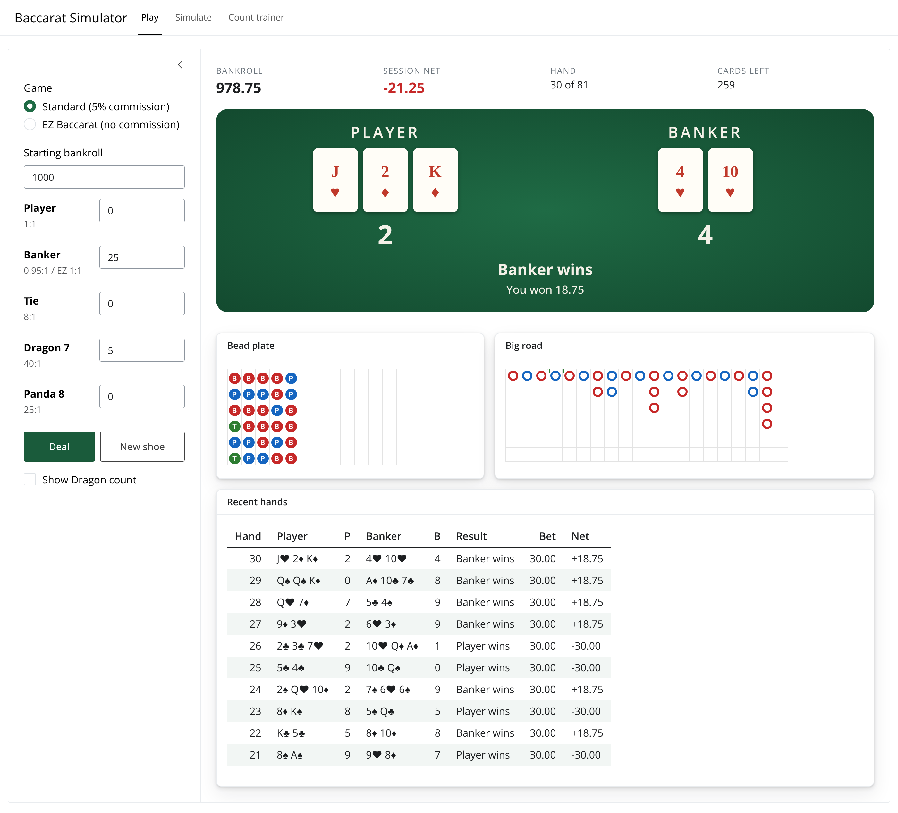
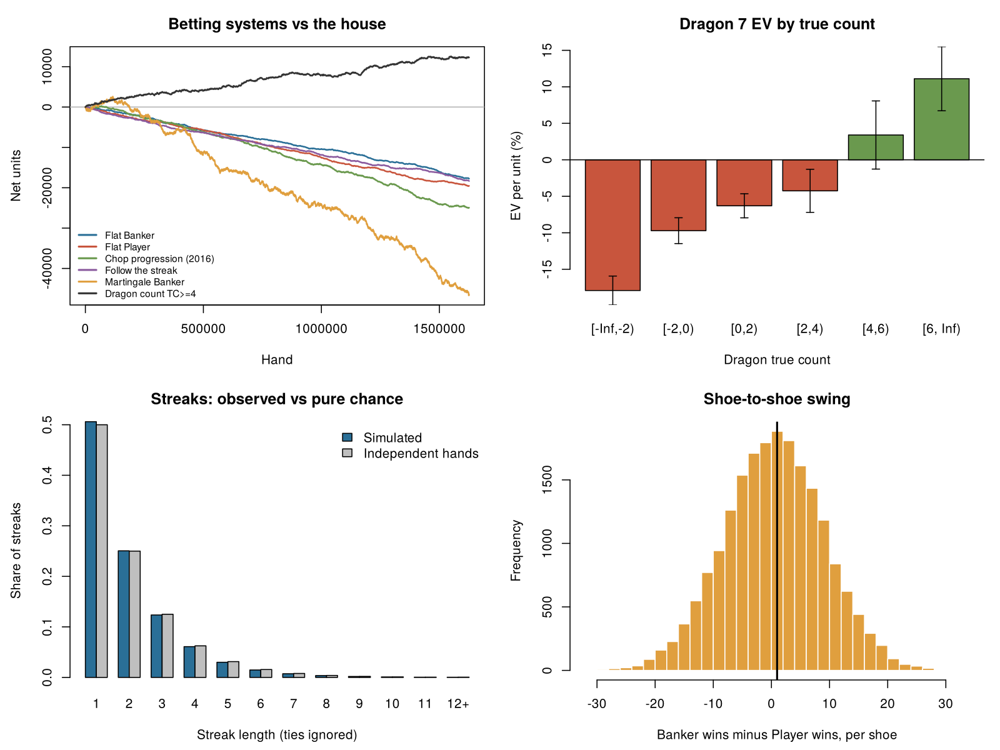

# gitCasinoGame
A simulation of Baccarat (Punto Banco) in R, used to study its central tendencies, patterns,
betting systems and side-bet card counting.

## User interfaces

Both interfaces have the same three tabs:

* **Play**: each shoe starts by showing the burn: the first card face up, then that many
  cards face down (10 for 10/J/Q/K). Deal hand by hand and bet on Player, Banker, Tie,
  Dragon 7 and Panda 8, with a bead plate, Big Road and an optional Dragon count. Turn on
  **Auto-bet** to let a betting system place the bets, and **Autoplay** to run it for N hands.
* **Simulate**: set shoes, decks, cut card, game and seed, then compare simulated vs exact
  house edge, betting systems, and Dragon 7 return by true count.

### Betting systems

Every system is a choice of **side** (Banker, Player, opposite of the last result, or same as the
last result) combined with a **bet-sizing rule**: Flat, Martingale, Paroli, Fibonacci, D'Alembert,
1-3-2-6, Labouchère, Oscar's Grind, the 2016 chop progression, or the Dragon count. Settings:
base bet, table maximum, maximum progression steps, and a stop-loss and take-profit per shoe.
Ties (and, in EZ Baccarat, a Banker bet on a Dragon 7) are pushes and leave the progression unchanged.

```r
cfg <- system_config("Martingale", side = "B", base = 10, table_max = 1000, max_steps = 6)
run <- play_strategy(h, cfg, game = "standard")
compare_strategies(h, default_systems(side = "opposite", stop_loss = 200))
```
* **Count trainer**: practise the Dragon 7 count with timed auto-deal, periodic quizzes and
  an optional practice mode that shows each card's tag.

### Shiny app (`app.R`)

The Shiny app runs on the tested R engine in `baccarat.R`.

```r
install.packages("shiny")   # once
shiny::runApp()             # from the repo folder, or open app.R in RStudio and click Run App
```



### Browser version (`web/index.html`)

A single self-contained page with the same engine ported to JavaScript. It reproduces the same
exact odds and needs no R. Open the file in any browser, or enable GitHub Pages to host it.

## v2: `baccarat.R`

A rewrite of the 2016 simulator. It uses base R only and needs no packages.

* **Accurate and checked.** `exact_odds()` enumerates every 8-deck deal and reproduces the published
  probabilities (Banker 0.458597, Player 0.446247, Tie 0.095156). `tests.R` checks the drawing rules
  hand by hand and confirms the simulator agrees with the exact numbers.
* **Faster.** Cards are integers rather than strings, so it runs about 5× faster than the 2016 code
  (1,000 shoes in about 0.7 s).
* **Real payouts.** Supports standard Baccarat (5% commission) and EZ Baccarat (Banker pushes on Dragon 7).
  Side bets are Tie 8:1, Dragon 7 40:1 and Panda 8 25:1.
* **Casino procedure.** Burn cards are sized by the first card. When the cut card comes out, one more
  hand is dealt.
* **Dragon 7 counting.** Uses Eliot Jacobson's tags (4–7 = −1, 8–9 = +2). The running and true count
  are recorded before every hand.
* **Betting systems.** Strategies plug in as functions, and the 2016 chop progression is included.
  Each run records units wagered, net result, return and worst drawdown.
* **Display and plots.** Card-by-card shoe display with a bead plate, plus a four-panel report.

```r
source("baccarat.R")
play_shoe(verbose = TRUE)                 # watch one shoe dealt
h <- simulate_shoes(5000, seed = 42)      # one row per hand
house_edge(h, game = "ez")                # simulated vs exact house edge
compare_strategies(h)                     # betting systems head to head
dragon_by_count(h)                        # Dragon 7 EV by true count
shoe_summary(h)                           # per-shoe table like 2016 simulplay()
plot_report(h, file = "report.png")
```

To write your own strategy, give it a function that takes `state` (`last`, `streak`, `losses`, `tc`)
and returns `list(bet = "P"/"B"/"T"/"D"/"none", units = n)`. Then run it with `play_strategy(h, fn)`.

### Results from 20,000 shoes (1.6M hands)



| Strategy | Return per unit wagered |
|---|---|
| Flat Banker | −1.09% |
| Flat Player | −1.20% |
| Chop progression (2016) | −1.13% |
| Follow the streak | −1.13% |
| Martingale Banker | −0.98% (but needs 3× the action and has the deepest drawdown) |
| Dragon 7 only at true count ≥ +4 | **+7.6%** (on about 10% of hands) |

Progressions and pattern-following can't change the house edge, because streak lengths match
independent hands exactly. Counting the Dragon 7 side bet is the only approach here that wins.

Run the tests with `Rscript tests.R`.

## 2016 files

`BaccaratAnalysis.R`, `BaccaratAnalysisPreload.R` and `BaccaratAnalysisPreloadNC.R` are the original
simulator, kept for reference. They were patched to run on R ≥ 4.2 (the `class(s) == "matrix"` check),
so they no longer crash on shoes with no Banker or Player run or with a single run, and naturals now
record their real point spread.
